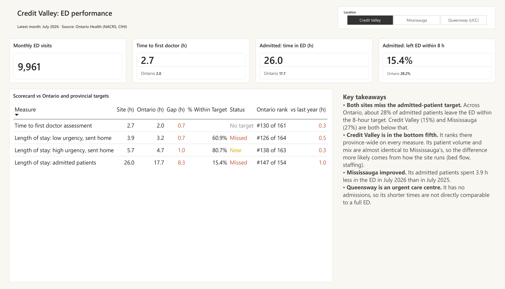
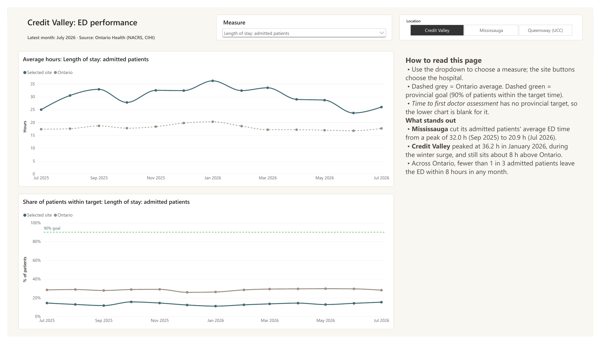
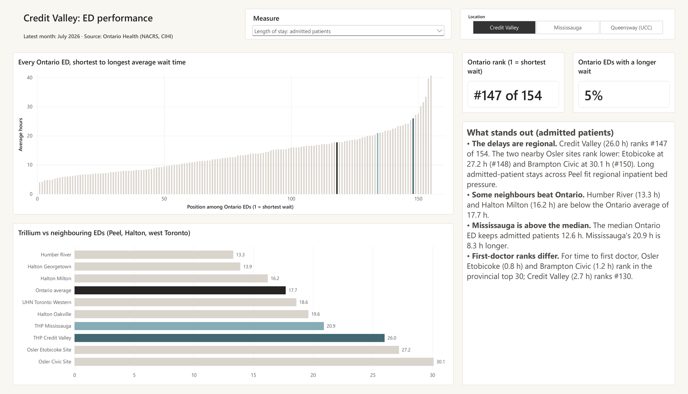
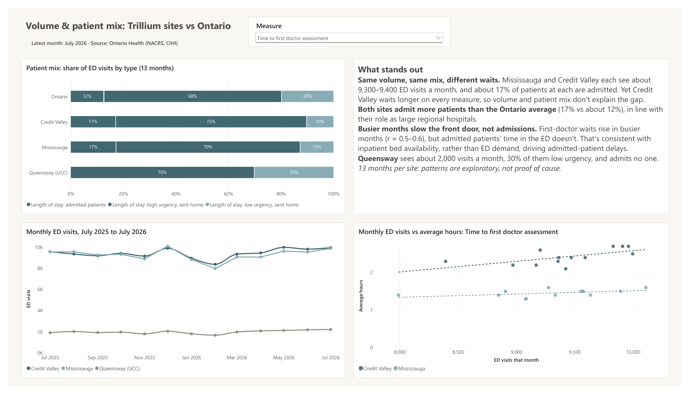
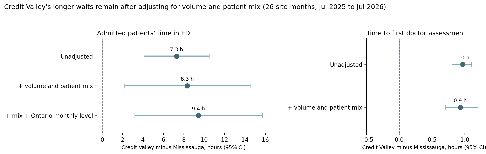

# Ontario ER wait-time scorecard: Trillium Health Partners

This is a five-page Power BI scorecard. It compares emergency department (ED) wait times at Trillium Health Partners' three Mississauga-area sites with the Ontario average, the provincial targets and neighbouring hospitals. The data is 13 months of public Ontario Health reporting (July 2025 to July 2026) plus a July 2026 provincial ranking of 150+ EDs.

## Key findings

- In July 2026, 15.4% of admitted patients at Credit Valley and 27.4% at Mississauga left the ED within the 8-hour target. The Ontario figure was 28.2%, and the provincial goal is 90%.
- Credit Valley ranks in the bottom fifth of Ontario EDs on every measure. For admitted patients' time in the ED it is #147 of 154, at 26.0 h against 17.7 h for Ontario.
- Two nearby EDs rank lower still: Osler Etobicoke (27.2 h, #148) and Brampton Civic (30.1 h, #150). Humber River (13.3 h) and Halton Milton (16.2 h) are below the Ontario average. This pattern fits inpatient bed pressure across Peel.
- Mississauga and Credit Valley each see about 9,300 to 9,400 visits a month, and about 17% of patients are admitted at each site. Credit Valley still waits longer on every measure. In a regression across 26 site-months, Credit Valley's admitted patients spend 7.3 h longer in the ED than Mississauga's; after adjusting for monthly volume and patient mix the gap is 8.3 h (95% CI 2.2 to 14.5).
- Time to first doctor rises with monthly volume (r = 0.48 to 0.62). Admitted patients' time in the ED does not (r = −0.10 to −0.60). That is consistent with bed availability driving admitted-patient delays, with ED demand playing a smaller part.
- Mississauga's admitted patients spent 3.9 h less in the ED in July 2026 than in July 2025. The monthly average peaked at 32.0 h in September 2025 and was 20.9 h in July 2026.

With 13 months per site, the volume and wait-time correlations and the regression are exploratory. They do not prove cause.

## Report pages

- Scorecard: KPI cards and a table for the selected site, with the value against Ontario, the gap, % within target, Met/Near/Missed status, provincial rank and change from last year.
- Trends: a 13-month trend for any measure, comparing the selected site with Ontario, plus % within target against the 90% goal.
- Province ranking: every Ontario ED from shortest to longest wait, and Trillium against neighbouring EDs in Peel, Halton and west Toronto.
- Volume & patient mix: share of visits by patient type, monthly visits, and a scatter plot of monthly volume against wait time.
- Methods & caveats: data source, definitions, build steps and limitations.

*Credit Valley's gap compared with Mississauga, with 95% confidence intervals (OLS, 26 site-months). The gap does not shrink after adjusting for monthly volume and patient mix, so Credit Valley being busier or seeing sicker patients does not explain it. Made by `er_analysis.py`.*

## How it was built

- Power Query combines 30 CSV exports from one folder. It splits each file name into site, measure and metric, converts `202507`-style months to dates, handles the "NV" and "NDA" codes, and unpivots the data so Ontario is its own row (533 rows). It also stacks the 4-sheet ranking workbook into one table.
- The data model has a measure lookup table (labels, targets, sort order) with one-to-many relationships to the trend and ranking tables.
- DAX measures calculate latest-month values, the Ontario benchmark (`CALCULATE`), gap to Ontario, target status, provincial rank with ties, year-over-year change (`EDATE`), dynamic titles, and colours for conditional formatting.
- The report uses synced slicers, edited visual interactions, dynamic chart titles, a constant goal line, and the same custom theme as my previous project.
- `er_analysis.py` (pandas) rebuilds the data model from the raw exports and reproduces every number in the report, including the patient mix and the volume and wait-time correlations.
- The regression (statsmodels) is ordinary least squares with robust (HC3) standard errors. It tests whether Credit Valley's gap shrinks once monthly volume, share admitted and share of high-urgency patients are controlled for. The admitted-patient gap goes from 7.3 h unadjusted to 8.3 h adjusted, and to 9.4 h when Ontario's monthly level is also included. The time-to-first-doctor gap stays at about 0.9 h.
- A hidden QA page in the report was cross-checked against the Python output.

## Repository contents

- `ER_Wait_Time_Scorecard.pbix`: the Power BI report (open with Power BI Desktop)
- `Goldenitz_ER_Wait_Time_Scorecard.pdf`: a static PDF of all five pages
- `er_analysis.py`: Python validation, statistics and regression
- `data/trends/`: 30 monthly CSV exports named `Site_Measure_Metric.csv` (avg = average hours, pct = % within target, vol = patient count)
- `data/hospital_rankings_2026-07.xlsx`: the July 2026 hospital comparison table, one sheet per measure
- `images/`: page screenshots and the regression chart

## How to run

Power BI: open the `.pbix` in Power BI Desktop. To refresh, go to Transform data > Data source settings and point the two sources to your copies of `data/trends/` and `data/hospital_rankings_2026-07.xlsx`.

Python: install pandas, numpy, openpyxl, statsmodels and matplotlib (`pip install pandas numpy openpyxl statsmodels matplotlib`), then run `python er_analysis.py` from the repository folder.

## Data

Ontario Health, [Time Spent in Emergency Departments](https://ontariohealth.ca/system/reporting/performance/time-spent-in-emergency-departments), based on the National Ambulatory Care Reporting System (NACRS) from the Canadian Institute for Health Information (CIHI). Exported September 2026. All data is public and aggregated. No patient-level data was used.

Definitions: low urgency is CTAS 4 to 5 (target 4 h); high urgency is CTAS 1 to 3, not admitted (target 8 h); admitted patients have an 8 h target. The provincial goal is 90% of patients within target. Queensway Health Centre is an urgent care centre with no admissions, so it is not directly comparable to a full ED.

## Author

Michael Goldenitz, Applied Data Analytics and Visualization, Sheridan College. HBSc Psychology and Philosophy, University of Toronto Mississauga.
[LinkedIn](https://www.linkedin.com/in/michael-goldenitz-790509265/) · [GitHub](https://github.com/mgoldenitz)
